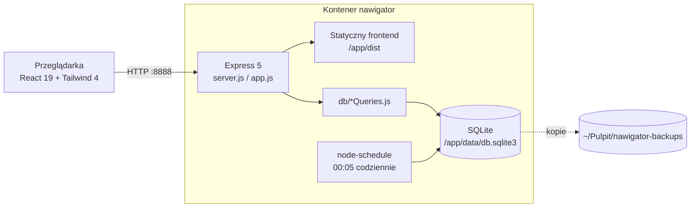
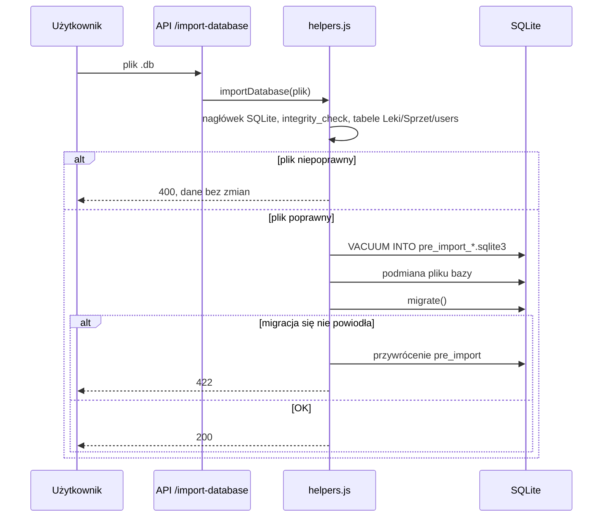

# Architektura

Nawigator to aplikacja do inwentaryzacji leków i sprzętu medycznego na statku. Działa na starym laptopie
(4 GB RAM, Linux Mint), dlatego całość to **jeden proces Node.js w jednym kontenerze Docker** (~35 MB RAM).

## Warstwy

| Katalog | Rola |
|---|---|
| `src/` | Frontend (React). Strony w `src/pages`, modale w `src/components`, generatory PDF w `src/utils` (ładowane dopiero przy generowaniu PDF). |
| `backend/server.js` | Start: migracja bazy, nasłuch HTTP, zadanie nocne. |
| `backend/app.js` | Budowa aplikacji Express (bez efektów ubocznych – używana też w testach). Serwuje `dist/`, gdy ustawiono `STATIC_DIR`. |
| `backend/routes/` | Endpointy REST + walidacja (`express-validator`, wspólne helpery w `validate.js`). |
| `backend/db/` | Zapytania SQL, schemat, triggery i migracja (`schema.js`). |
| `backend/utils/helpers.js` | Kopie zapasowe, eksport, walidacja i import bazy. |
| `backend/middleware/` | Kopia po każdej zmianie (debounce 2 s), obsługa błędów. |

## Najważniejsze decyzje

- **Jeden proces, jeden port (8888).** Wcześniej frontend działał na serwerze deweloperskim Vite (kilkaset MB RAM), a backend w osobnym kontenerze.
- **SQLite + triggery.** Statusy (`status_leku`, `status`, `termin`, `ilosc_termin`) liczą triggery w bazie – opis w [baza-danych.md](baza-danych.md).
- **Daty jako tekst `DD-MM-YYYY`.** Tak zapisywały je wcześniejsze wersje; migracja ujednolica starsze formaty.
- **Migracja przy każdym starcie i imporcie** (`migrate()` w `backend/db/schema.js`) – idempotentna, pozwala importować eksporty ze starych wersji.
- **Logowanie po stronie serwera** (`POST /api/login`) z tymi samymi zasadami co wcześniej; API nie zwraca haseł. Uprawnienia (admin/user/viewer) są nadal sprawdzane tylko w interfejsie.

## Przepływ importu bazy

## Nieużywany kod (outdated)

Te pliki zostają w repo, ale nie są dostępne z aplikacji. Mają na górze komentarz „OUTDATED”:

| Plik | Co to jest | Dlaczego nieużywane |
|---|---|---|
| `src/pages/Eq/OrganizedEquipment.jsx` | strona „Zgrany spis sprzętu” (tabela `Sprzet_zgrany_spis`, API `/api/sprzet-zgrany*` działa) | brak trasy w `App.jsx` i linku w menu |
| `src/components/AddItemToUtilizationModal.jsx` | ręczne dodanie do utylizacji pozycji spoza spisu | renderowane w `UtilizationList`, ale żaden przycisk go nie otwiera |

Przed ponownym podpięciem trzeba je przetestować. Nie były objęte poprawkami UI z listopada 2026, poza statusami i nazwami pól.
