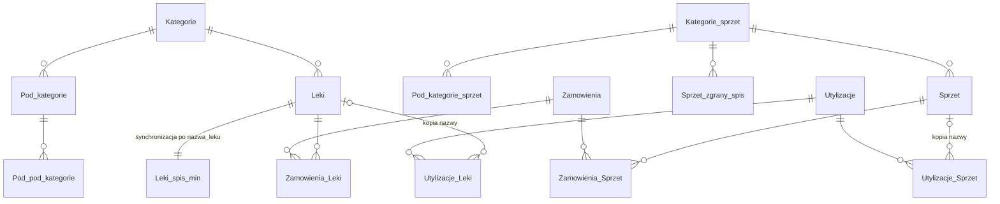
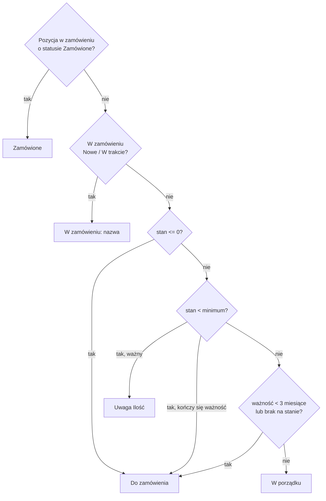

# Baza danych

SQLite w jednym pliku (`DB_PATH`, w kontenerze `/app/data/db.sqlite3`). Schemat, triggery i migracja: `backend/db/schema.js`.

## Tabele

| Tabela | Zawartość |
|---|---|
| `Leki` | Główny spis leków: `ilosc_wstepna`, `rozchod_ilosc` (stan = różnica), `ilosc_minimalna`, `data_waznosci`, statusy, historia dostaw w `important_status` (`5x31-12-2027; …`). |
| `Leki_spis_min` | Spis minimum leków. Dodanie/zmiana/usunięcie po jednej stronie trafia triggerem do drugiej (dopasowanie po `nazwa_leku`). |
| `Sprzet` | Spis sprzętu: `ilosc_wymagana`, `ilosc_aktualna`, statusy, historia dostaw w `status`. |
| `Sprzet_zgrany_spis` | Zgrany spis sprzętu (daty w formacie `YYYY-MM-DD` – tak zapisuje je formularz). |
| `Zamowienia`, `Zamowienia_Leki`, `Zamowienia_Sprzet` | Zamówienia i ich pozycje. Klucze obce: nie można usunąć leku/sprzętu użytego w zamówieniu (API zwraca 409). |
| `Utylizacje`, `Utylizacje_Leki`, `Utylizacje_Sprzet` | Utylizacje. Pozycje przechowują kopię nazwy, więc historia zostaje po usunięciu leku/sprzętu. |
| `users` | Użytkownicy: `username`, `password` (jawny tekst – zgodność ze starymi bazami), `position` = `admin` / `user` / `viewer`. |
| `Utylizacja`, `Uzytkownicy`, `last_ids_temp` | Pozostałości starszych wersji – nieużywane, zostawione dla zgodności. |

## Statusy

Dwa niezależne statusy na pozycję:

| Lek | Sprzęt | Znaczenie |
|---|---|---|
| `status_leku` | `termin` | ważność: `Przeterminowane`, `Ważność 1 miesiąc`, `Ważność 3 miesiące`, `Brak na stanie`, `Ważny` |
| `status` | `ilosc_termin` | stan/zamówienie: `W zamówieniu: <nazwa>`, `Zamówione`, `Do zamówienia`, `Uwaga Ilość`, `W porządku` |

- Ważność liczą triggery przy dodaniu/zmianie daty oraz **zadanie nocne o 00:05** (`refreshStatuses()`), bo zależy od dzisiejszej daty.
- Przy starcie serwera `updateStatusTrigger()` oznacza pozycje ze wszystkich aktywnych zamówień jako `Zamówione` (zachowanie z poprzednich wersji).
- Zmiana statusu zamówienia na **Przyjęte** dodaje zamówione ilości do stanu **tylko raz** (ponowne zapisanie tego samego statusu nic nie dodaje), dopisuje `ilość x data` do historii i ustawia datę ważności, jeśli pozycji nie było na stanie lub nie miała daty.

## Migracja (`migrate()`)

Uruchamiana przy każdym starcie i po każdym imporcie, idempotentna:

1. `CREATE TABLE IF NOT EXISTS` dla wszystkich tabel (stare eksporty nie mają np. `Zamowienia*`, `Utylizacje*`).
2. Dodanie brakujących kolumn – wzorcem jest schemat zbudowany w bazie `:memory:`.
3. Odtworzenie triggerów (stare bazy mają triggery odwołujące się do nieistniejących tabel).
4. Daty `YYYY-MM-DD` i `D.M.YYYY` → `DD-MM-YYYY` (wartości nieparsowalne zostają bez zmian).
5. Przeliczenie statusów.
6. Jeśli tabela `users` jest pusta – utworzenie użytkownika `admin` bez hasła.
